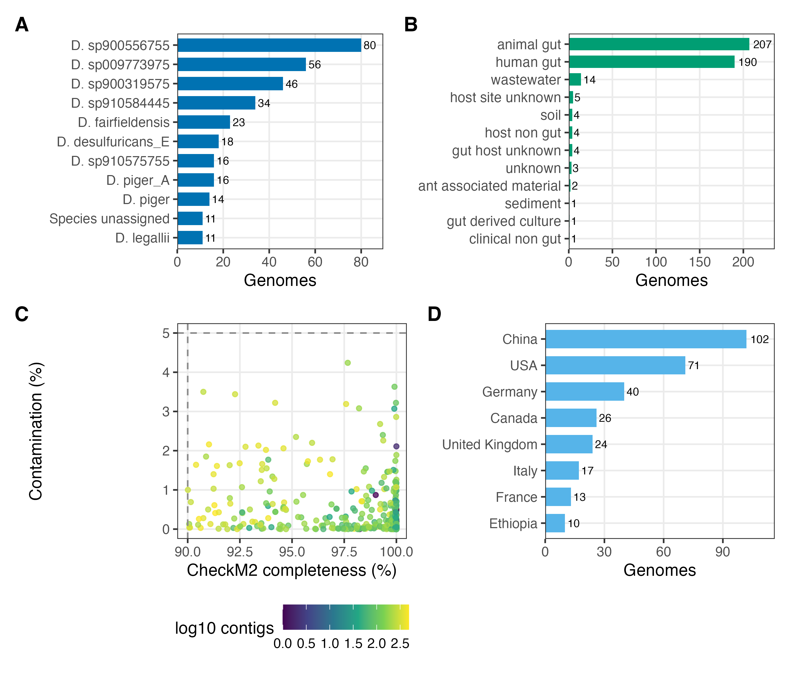

---
author:
- name: Jinlong Ru
- name: Cunli Pan
params:
  name: 110-figure1-cohort
subtitle: Redraw fig1_cohort from frozen records
title: 110-figure1-cohort
---

This step reads the registered frozen inputs. It does not fit models,
run bootstrap resampling, call annotations or update the original
database. See the [output map](../metadata/result-code-map.tsv) and
[reproducibility scope](../docs/reproducibility.md).

## Tasks

``` r
pc057_draw_figure(step, "fig1_cohort")
```

``` r
receipt <- pc057_step_finish(step)
print(receipt)
```

    ##                 step status          output
    ## 1 110-figure1-cohort   pass fig1_cohort.pdf
    ## 2 110-figure1-cohort   pass fig1_cohort.png

<figure>

<figcaption aria-hidden="true">plot of chunk figure</figcaption>
</figure>
