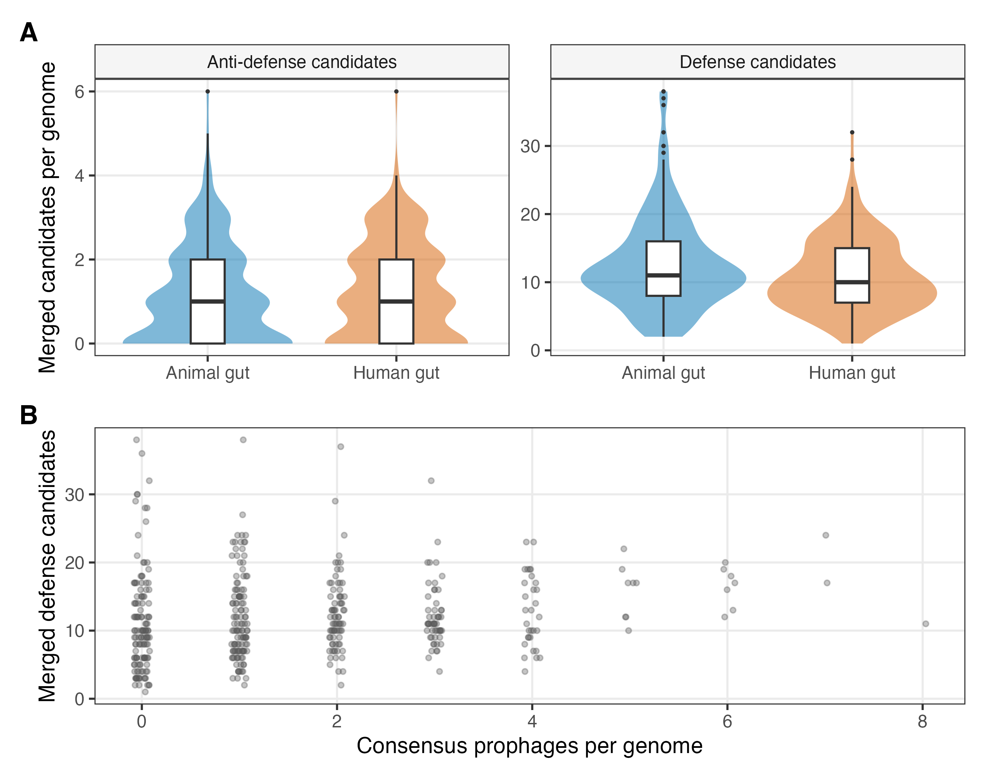

# 120-figure2-catalog
Jinlong Ru, Cunli Pan

## Tasks

``` r
pc057_draw_figure(step, "fig2_catalog")
```

``` r
receipt <- pc057_step_finish(step)
print(receipt)
```

    ##                  step status           output
    ## 1 120-figure2-catalog   pass fig2_catalog.pdf
    ## 2 120-figure2-catalog   pass fig2_catalog.png

<figure>

<figcaption aria-hidden="true">plot of chunk figure</figcaption>
</figure>
