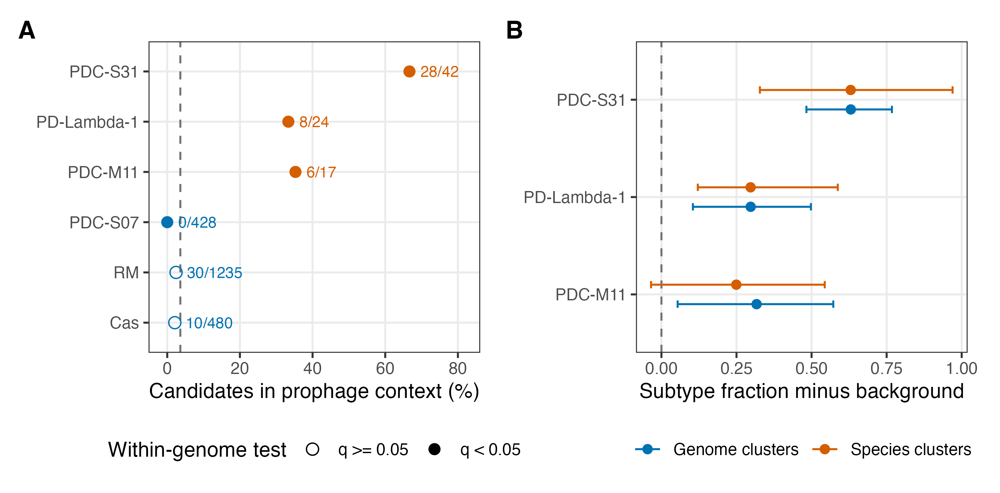

# 130-figure3-enrichment
Jinlong Ru, Cunli Pan

## Tasks

``` r
pc057_draw_figure(step, "fig3_enrichment")
```

``` r
receipt <- pc057_step_finish(step)
print(receipt)
```

    ##                     step status              output
    ## 1 130-figure3-enrichment   pass fig3_enrichment.pdf
    ## 2 130-figure3-enrichment   pass fig3_enrichment.png

<figure>

<figcaption aria-hidden="true">plot of chunk figure</figcaption>
</figure>
