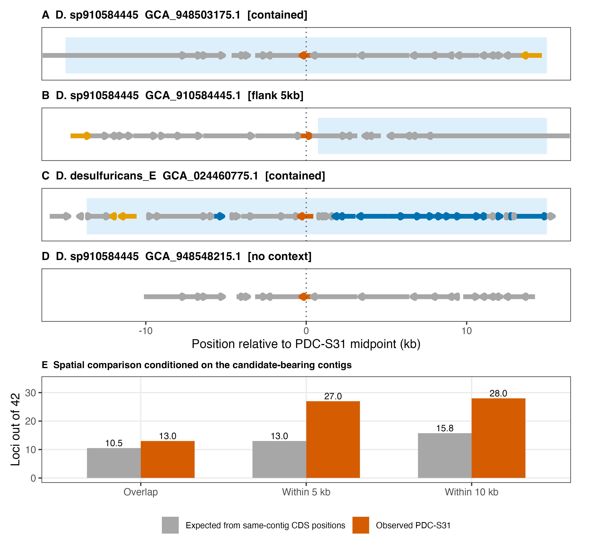

# 140-figure4-neighborhood
Jinlong Ru, Cunli Pan

## Tasks

``` r
pc057_draw_figure(step, "fig4_neighborhood")
```

``` r
receipt <- pc057_step_finish(step)
print(receipt)
```

    ##                       step status                output
    ## 1 140-figure4-neighborhood   pass fig4_neighborhood.pdf
    ## 2 140-figure4-neighborhood   pass fig4_neighborhood.png

<figure>

<figcaption aria-hidden="true">plot of chunk figure</figcaption>
</figure>
