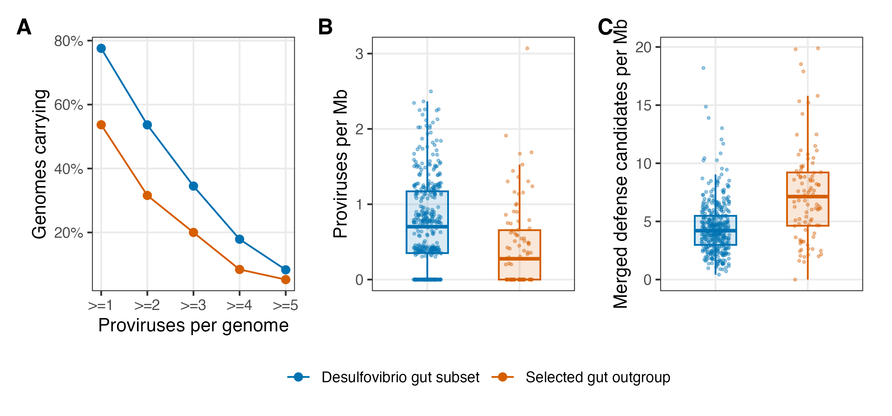

# 150-figure5-outgroup
Jinlong Ru, Cunli Pan

## Tasks

``` r
pc057_draw_figure(step, "fig5_outgroup")
```

``` r
receipt <- pc057_step_finish(step)
print(receipt)
```

    ##                   step status            output
    ## 1 150-figure5-outgroup   pass fig5_outgroup.pdf
    ## 2 150-figure5-outgroup   pass fig5_outgroup.png

<figure>

<figcaption aria-hidden="true">plot of chunk figure</figcaption>
</figure>
