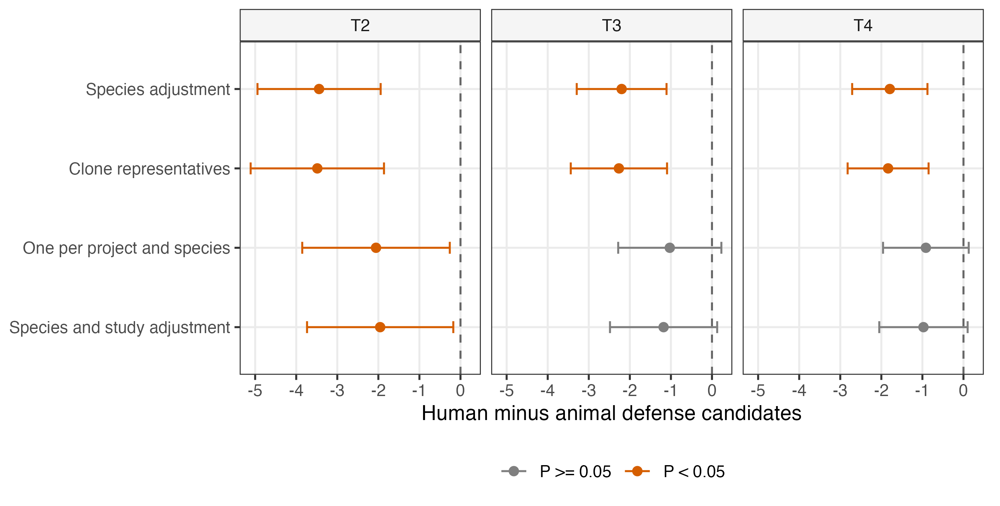

# 160-figureS1-ecology
Jinlong Ru, Cunli Pan

## Tasks

``` r
pc057_draw_figure(step, "figS1_ecology")
```

``` r
receipt <- pc057_step_finish(step)
print(receipt)
```

    ##                   step status            output
    ## 1 160-figureS1-ecology   pass figS1_ecology.pdf
    ## 2 160-figureS1-ecology   pass figS1_ecology.png

<figure>

<figcaption aria-hidden="true">plot of chunk figure</figcaption>
</figure>
